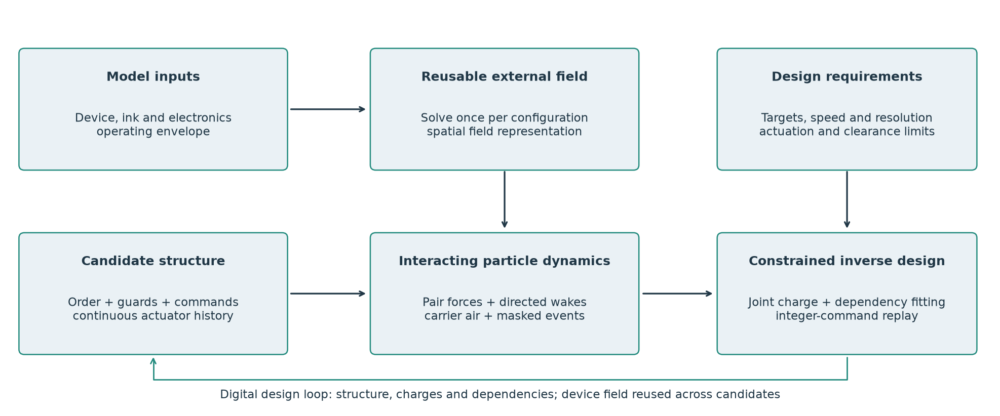

# GPU-Accelerated Simulation and Inverse Design of Interacting Dynamical Systems

**Matteo Trapasso**

[Paper](paper/main.pdf) · [Source](paper/main.tex) · [Reproduction](docs/REPRODUCTION.md) · [Data](docs/DATA.md)

A GPU-accelerated multiphysics simulation and inverse-design framework for interacting particle systems. It combines reusable device fields, dynamic pairwise interactions, event handling and constrained optimization to explore operating parameters, emission schedules and realizable control commands.

The physical model combines imposed fields, reciprocal electrostatic forces, directed aerodynamic wakes, drag and discrete particle events. Batched trajectory evaluation connects these interactions to constrained parameter optimization, structure search and realizable command representations.

The framework supports offline control design and produces trajectory and force data for future learned surrogates and intelligent control strategies. The accompanying paper documents the implemented physical assumptions, application-specific evidence and limits of the demonstrated results.

Repository: [gpu-accelerated-interacting-dynamics](https://github.com/blavingad/gpu-accelerated-interacting-dynamics).



## Results

Two application cases assess 644 preceding/current-stroke contexts each. Experimental coordinates are ten-print A–Z means at 75 kHz, with substrate speeds of 50 and 100 m/min.

| Metric | Low speed | High speed |
| --- | ---: | ---: |
| Deflection RMSE | 16.12 µm | 21.58 µm |
| Substrate-direction RMSE | 20.97 µm | 31.23 µm |
| 2D RMSE | 26.45 µm | 37.96 µm |

Fixed-command ablations and Euler/RK4 comparisons assess model and numerical sensitivity. The matched endpoint batch runs 5.20× faster on GPU on the tested workstation. See [numerical studies](docs/NUMERICS.md) for workload definitions and scope.

## Install

```bash
python -m venv .venv
source .venv/bin/activate
python -m pip install -e .
```

Requires Python 3.11+. Tested versions are in `requirements-tested.txt`; GPU execution requires a compatible JAX/CUDA runtime.

## Reproduce

```bash
python -m unittest discover -s tests
python workflows/assess_prints.py
python workflows/reproduce_figures.py
python workflows/draw_methodology.py
python workflows/build_manuscript.py
```

Install Tectonic and set `CIJ_TECTONIC` if needed. To compile the existing article directly, run `python workflows/build_paper.py --engine /path/to/tectonic`.

## Simulation and design

```bash
python workflows/evaluate_context_pool.py --case low --device cpu --batch 4 --smoke
python workflows/fit_shared_tables.py --case low --epochs 2 --batch 64
python workflows/optimize_full_stroke.py --device cpu
python workflows/search_structures.py --samples 10000 --physical 16 --prepare-only
```

Generated output goes to `results/generated/`. The [reproduction guide](docs/REPRODUCTION.md) covers full-pool assessment, charge fitting, recording, benchmarking and measurement updates.

## Files

| Directory | Contents |
| --- | --- |
| `src/vdcr/` | Physics, charging, field interpolation and design support |
| `workflows/` | Simulation, optimization, checks and paper builds |
| `inputs/` | Field, font, case inputs and controller tables |
| `results/numerical/` | Frozen ablation, integration and benchmark results |
| `results/experimental/` | Current coordinate assessment |
| `results/reference/` | Original campaigns and superseded assessments |
| `paper/` | PDF, LaTeX, figures and evidence tables |
| `docs/parameters/` | Model settings and input inventory |

Additional laboratory records remain confidential. The supplied field supports replay; its original CFD mesh is outside the repository. Case definitions, context coverage and model limits are documented in the paper.

## Citation and license

Citation metadata is in [CITATION.cff](CITATION.cff). Licensed under [Apache 2.0](LICENSE); see [NOTICE](NOTICE).
